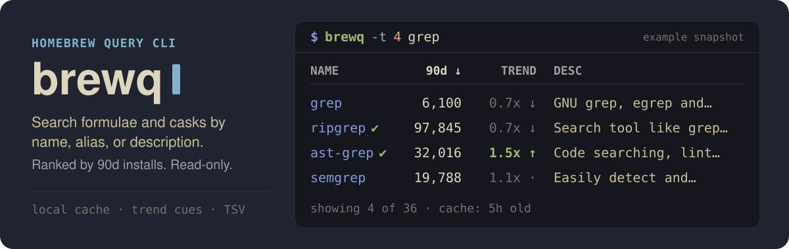

`brewq` is a compact, read-only Homebrew query tool: search formulae and casks by name, formula alias, or description, compare 90-day installs and momentum cues, and inspect installed packages from a local cache. It never installs, upgrades, manages services, or manages Brewfiles.

Pre-1.0 (`0.x`, [changelog](CHANGELOG.md)) · local wheel distribution · MIT ([LICENSE](LICENSE), [NOTICE](NOTICE))

## Install & quick start

Requires Python 3.12+, `uv`, and Homebrew (for local installed inventory and register updates).

Install from a local wheel (replace the path with your `.whl` file) and run your first search:

```bash
uv tool install path/to/brewq-*.whl
brewq ripgrep
```

In a checkout, run source directly without installing, and compare `brewq --version` with `uv run brewq --version` if checking for version drift:

```bash
uv run brewq ripgrep
```

Optionally link the `bq` shorthand beside `brewq`:

```bash
brewq +setup --dry-run   # preview the link without changing anything
brewq +setup             # link `bq` beside `brewq` when free
bq ripgrep
```

`uv tool install` installs `brewq` only. `+setup` links `bq` beside it only when that name is free and is not a shell alias or function; a foreign `bq` is left unchanged, and `brq` is not created.


## Workflows

**Search and compare:**

```bash
brewq                              # top overall; fits the terminal height
brewq -s trend                     # top rising packages
brewq terminal multiplexer         # multi-term search across names and descriptions
brewq -t 10 json                   # cap to top 10 matches
brewq -u ripgrep                   # attempt a forced refresh, then search
```

Example output (counts vary by snapshot):

```console
$ brewq -t 6 grep
NAME         90d ↓    TREND  DESC
────────────────────────────────────────────────────────────────────────────────
grep         6,100  0.7x ↓   GNU grep, egrep and fgrep
ripgrep ✔   97,845  0.7x ↓   Search tool like grep and The Silver Searcher
ast-grep ✔  32,016  1.5x ↑   Code searching, linting, rewriting
semgrep     19,788  1.1x ·   Easily detect and prevent bugs and anti-patterns i…
ugrep        8,316  0.7x ↓   Ultra fast grep with query UI, fuzzy search, archi…
ack ✔        1,566  0.4x ↓   Search tool like grep, but optimized for programme…
brewq: showing 6 of 36; -a for all, -t N for a count
cache: 5h old
```

Install counts are a comparison signal, not proof of quality; queries run locally against cached metadata and analytics.

**Installed packages (`-i`):**

```bash
brewq -i                           # installed formulae and casks (capped to terminal height)
brewq -i -a                        # all installed packages, best rows last on a TTY
brewq -i grep                      # filter installed packages by query
brewq -i -s name                   # sort installed packages by name (inactive rows last)
brewq -i -c default,90d,trend      # add cached analytics columns
```

`-i [query]` is the only installed view, following the same sorting, caps, `-a`, `-r`, and status ranking as search. Analytics come from the local cache and are never fetched on demand; `VER` displays the installed version separately from the catalog version.

**Columns and TSV scripting (`-c`, `--tsv`):**

```bash
brewq ripgrep -c default,ver,bin      # configured view, then version and binaries
brewq rust -c name,90d,url,desc       # exact selection without trend
brewq ripgrep -c name,90d,url --tsv   # raw tab-separated rows, no header
brewq -i --tsv -c name,type,ver       # installed inventory for scripts
```

Example TSV output (ready for `awk`, `cut`, or shell loops):

```console
$ brewq ripgrep -c name,90d,url --tsv
ripgrep	97845	https://github.com/BurntSushi/ripgrep
ripgrep-all	887	https://github.com/phiresky/ripgrep-all
ripme	35	https://github.com/RipMeApp/ripme
```

## Reference

`brewq --help` shows the common path; `-f` (`--full-help`) adds the column reference, trending, and cache behavior; `-v` (`--version`) prints the version. Flags may appear before, between, or after query terms; `+action` dispatch applies only to the first token.

### Options

| Search option | Current behavior |
| --- | --- |
| `-s`, `--sort FIELD` | `90d` (built-in default), `30d`, `365d`, `trend`, or `name` |
| `-r`, `--reverse` | Put the best rows last |
| `-t`, `--top N` | Positive result cap; overrides configuration |
| `-i`, `--installed` | Show installed packages, optionally filtered by query |
| `-u`, `--update` | Attempt a forced register refresh, then query available data |
| `-a`, `--all` | Remove the cap and put the best row last on a TTY |

| Output option | Current behavior |
| --- | --- |
| `-c`, `--columns COLS` | Exact ordered fields; `default` for the configured view |
| `-m`, `--tsv` | Selected columns as raw tab-separated rows, without a header |
| `-n`, `--no-color` | Suppress ANSI styling on stdout and stderr |
| `-q`, `--quiet` | Suppress routine status notes on stderr; errors and data-quality warnings still print |

### Columns & trend

| Field | Header | Meaning |
| --- | --- | --- |
| `name` | `NAME` | Package name |
| `type` | `TYPE` | `formula` or `cask` |
| `ver` | `VER` | Installed version when present; otherwise catalog version |
| `30d` | `30d` | Installs in the last 30 days (formula installs on request; cask-install feed) |
| `90d` | `90d` | Installs in the last 90 days (formula installs on request; cask-install feed) |
| `365d` | `365d` | Installs in the last 365 days (formula installs on request; cask-install feed) |
| `trend` | `TREND` | Smoothed recent rate relative to the package's earlier rate |
| `bin` | `BIN` | Executable names (declared cask binary artifacts when present; formulae require local installed data) |
| `url` | `URL` | Homepage URL |
| `desc` | `DESC` | Package description |

Fields have one exact name shared by `-c`, `-s` (for sortable fields), and configuration; typos suggest exact names without resolving them. Pass one `-c` with a comma-separated list: `default` expands the configured view (`name,90d,trend,desc` for search; `name,desc` for `-i`) and duplicates keep their first occurrence. Signed `+x`/`-x` tokens are rejected with the equivalent list. `default` can change between releases, so scripts should list concrete fields.

Search tables mark installed rows with `✔` (`-i` omits it) and prefix `DESC` with package status (`(deprecated)` or `(disabled)`). Selections that cannot fit fall back to labeled vertical records. Tables omit all-blank columns (never `NAME`), noting only explicitly named hidden fields on stderr. Human-readable URLs drop a leading `https://` and a root-path trailing `/`. `--tsv` is the sole machine-readable format: headerless, sanitized cells, retaining every selected column (with empty cells for unknown counts) and full raw values.

`trend` is a smoothed recent-to-historical rate multiplier, shown by default (`TREND`) but never the default sort. Momentum cues (`↑↑` ≥ 2x, `↑` ≥ 1.2x, `·`, `↓` < 0.8x) evaluate the displayed one-decimal ratio; cues, `✔`, and raw TSV multipliers all survive without color. Styling follows the terminal theme per stream on TTYs only; nonempty `NO_COLOR`, `TERM=dumb`, or `-n` disables styling on stdout and stderr, and pipes and TSV stay ANSI-free.

### Matching, ordering & limits

Ordinary search matches normalized names, formula aliases, and descriptions; every term must match. Substring matching, DidYouMean spelling corrections (which can add results), and Python `/regex/` patterns are supported. An omitted or empty query selects the whole catalog (`-i` selects installed packages), and empty results exit `0`.

Exact name/alias matches rank first under every sort even when inactive; other disabled/deprecated rows rank last and are never filtered out. Caps and optional reversal apply after ranking.

Terminal cap precedence is `-t N`, then `-a` (unlimited, best row last on a TTY), then configured `top`. Default `top = "auto"` fits `max(1, rows - 6)` table rows, reserving six lines for chrome and the next prompt. When narrow output switches to vertical records, auto-fit reserves four lines plus any hidden-column notices and counts wrapped field lines plus separators, keeping at least one record. Explicit `-t N` skips height adjustment, and either explicit counts or a single oversized vertical record can exceed terminal height (`-r` puts the best row last). Dimensions come from stdout's terminal (`LINES`/`COLUMNS` apply only without a TTY). Hidden rows report `showing N of M; -a for all, -t N for a count` on stderr. Pipes and TSV ignore configured caps and `reverse`: they stay uncapped and best-first unless `-t` or `-r` is given, and `-a` does not change their ordering.

## Cache & updates

```bash
brewq +update            # update the register if stale
brewq +update --force    # force recovery, including a recently corrupted cache
brewq +update --offline  # install the bundled catalog as the local cache, offline
brewq -u ripgrep         # attempt a forced refresh, then search
```

Releases bundle a sanitized seed catalog containing `homebrew/core` and `homebrew/cask` (builder-local paths and installed state removed). Loads validate the user snapshot, fall back to the seed after corruption, and reconcile installed state from local Homebrew roots. Local inventory overlays installed formulae (including installed third-party formulae) into search and `-i`; a successful empty inventory clears stale markers, while missing or unreadable roots preserve the last known state. Live refreshes pull the records returned by Homebrew's trusted-tap enumeration.

Stale, seed, and incomplete snapshots can schedule a detached background refresh that waits five minutes, checks system load, and may use the network. Opt out with `auto-update = false` or `BREWQ_NO_AUTO_REFRESH=1` (the environment value wins; an invalid value warns and keeps configuration). `brewq +update` runs in the foreground on request; cache notes print to stderr after rows flush. Snapshots record analytics completeness independently of file age: if metadata refreshes while analytics are unavailable, previous usable counts are retained, the snapshot is marked for repair, and the scheduler retries later.

`+update --offline` replaces the cache with the bundled catalog without contacting Homebrew and cannot combine with `--force`. `-u` attempts a forced refresh first, then queries available data — whether the refresh succeeds, another update is already in progress, or refresh fails (reported on stderr with fallback to local data or the bundled seed). The query's success sets the exit code. `BREWQ_NO_AUTO_REFRESH=1` suppresses background attempts only, not `-u`.

## Configuration

Configuration lives at `${XDG_CONFIG_HOME:-~/.config}/brewq/config.toml`, unless `BREWQ_CONFIG` overrides it. Bare `brewq +config` is `+config show`: every key's effective value as TOML with its source in a trailing comment.

`+config defaults` prints starter TOML. `+config edit` opens `$VISUAL` or `$EDITOR` (arguments like `code -w` work), creating a commented-out file if missing; invalid settings exit `1` after the editor exits, and editor failures pass through its code.

```bash
brewq +config show
bq +config defaults > config.toml
VISUAL="code -w" brewq +config edit
```

Built-in defaults:

```toml
top = "auto" # terminal height; positive integer = fixed cap; 0 = unlimited; -t overrides
sort = "90d"
reverse = false # terminal default; true or -a puts the best row last
columns = ["name", "90d", "trend", "desc"]
installed-columns = ["name", "desc"]
auto-update = true # false, or BREWQ_NO_AUTO_REFRESH=1, skips background updates
max-age = 86400 # seconds
```

`BREWQ_CACHE_DIR` overrides the cache directory. The config-only `auto` pseudo-column resolves to `90d`, `30d`, or `365d` from the top result. Keys are root-level long option names with typo suggestions. Column arrays take concrete names, plus `auto` for search; `default` is reserved for `-c`. Invalid settings emit a concise diagnostic and fall back field-by-field. `--help`, `--version`, and `+config defaults` do not load configuration. Persisting CLI flags via `--save` is not implemented.

## Shell completion & environment

```zsh
source <(brewq +completion zsh)   # after compinit; in a checkout, uv run brewq +completion zsh
```

Tab completes commands, flags, sort fields, comma-separated columns, and cached package names. Package suggestions read the existing user snapshot even when stale; an absent, unreadable, or invalid snapshot yields no package suggestions, and completion never initializes the seed, scans inventory, or refreshes data. Regenerate completion after moving or recreating the Python environment that generated it. Bash and fish are not supported.

| Code | Meaning |
| --- | --- |
| `0` | Success, including empty results and queries served from local data after a refresh failure |
| `1` | Operational failure: unusable cache, failed update; `+config edit` exits `1` on invalid settings |
| `2` | Usage error: unknown flags or actions, invalid option values |
| `130` | Interrupted (`Ctrl-C`); no traceback, no partial cache |
| `141` | Closed search pipe (`brewq … \| head`); no traceback |

`+config edit` passes through the editor's exit code. `--help` and `--version` exit `0` and ignore invalid configuration.

| Variable | Effect |
| --- | --- |
| `BREWQ_CONFIG` | Config file path; otherwise `${XDG_CONFIG_HOME:-~/.config}/brewq/config.toml` |
| `BREWQ_CACHE_DIR` | Cache directory; otherwise `${XDG_CACHE_HOME:-~/.cache}/brewq` |
| `BREWQ_NO_AUTO_REFRESH=1` | Disable background updates; wins over configuration (`1`/`true`/`yes`/`on`) |
| `NO_COLOR` | Nonempty value disables ANSI styling on both streams |
| `TERM=dumb` | Disables ANSI styling on both streams |
| `VISUAL`, `EDITOR` | Editor for `+config edit`, in that order |
| `COLUMNS`, `LINES` | Terminal-size fallback when stdout is not a TTY |

## Uninstall

```bash
brewq +setup --remove
uv tool uninstall brewq
```

Cache and config stay behind; to remove those too:

```bash
rm -rf "${XDG_CACHE_HOME:-$HOME/.cache}/brewq" "${XDG_CONFIG_HOME:-$HOME/.config}/brewq"
```

## License & development

Original `brewq` code is MIT, Copyright (c) 2026 Ivan Cherniukh ([LICENSE](LICENSE)). The bundled catalog is Homebrew data under the BSD-2-Clause license, and spell correction adapts Yuki Nishijima's DidYouMean under MIT; both notices are in [NOTICE](NOTICE).

Contributor workflow lives in [AGENTS.md](AGENTS.md). The layout lab runs with `uv run python scripts/random-layout.py [--seed N]` from a checkout, using the same layouts and normal search path.
